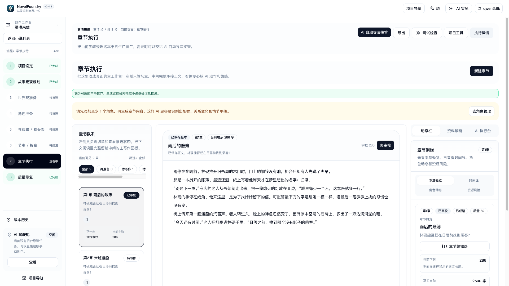
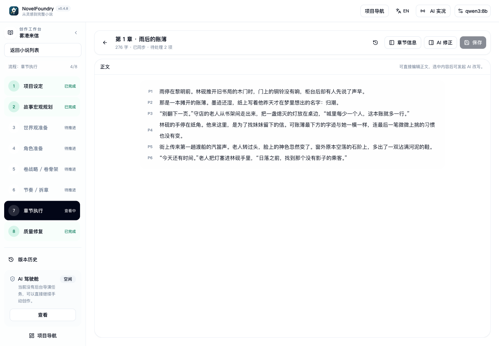
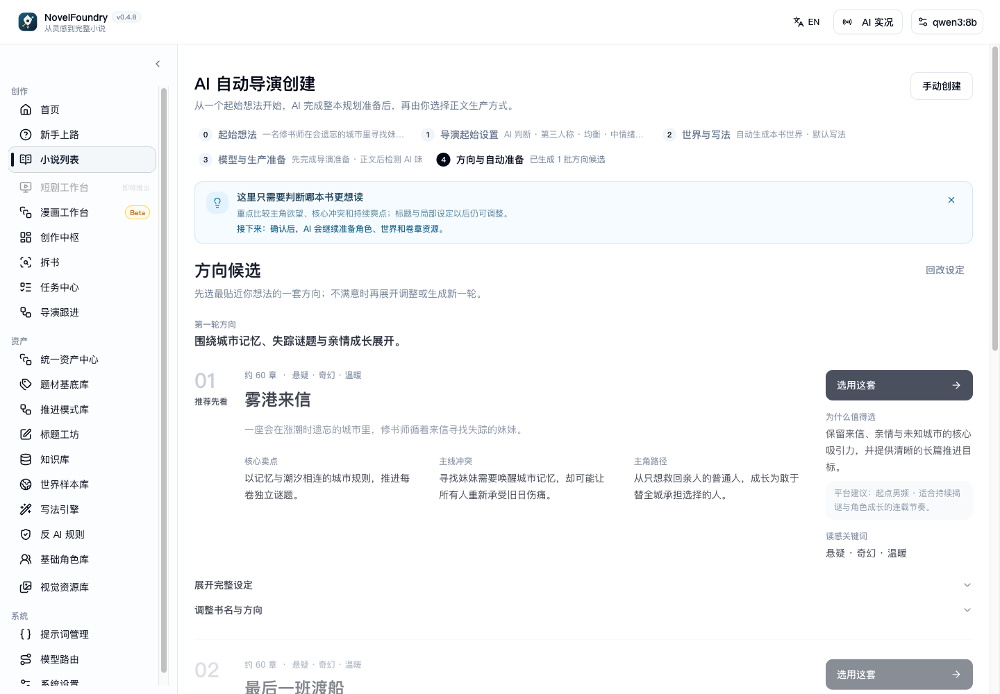

<div align="center">

# NovelFoundry

**From idea to a finished novel.**

An open-source AI-native writing workspace for first-time novelists.

[](LICENSE)
[](https://github.com/NathanielbeeLee/NovelFoundry/actions/workflows/ci.yml)


[Quick start](#quick-start) · [Features](#features) ·
[Workspace tour](#workspace-tour) · [Documentation](#documentation) ·
[Latest update](#latest-update) ·
[Contributing](CONTRIBUTING.md) · [Report an issue](https://github.com/NathanielbeeLee/NovelFoundry/issues)


</div>

Describe an idea and let AI guide you through story planning, worldbuilding,
character preparation, chapter writing, review, and repair. Follow the next
recommended action, read the saved chapters, and recover interrupted tasks as
you work toward a complete manuscript.

**Start with one working text model.** Image generation, vector retrieval, and
research tools are optional. The first milestone is a saved, readable chapter.

> **Active development.** Source code is available; a desktop installer has not
> been published in this repository yet. Chinese/English UI coverage is partial.
> See [FAQ](#faq) for language, model costs, and data-storage details.

## Quick start

| How you want to start | Go here |
| --- | --- |
| Run the current application | [Run from source](#run-from-source) |
| Check Windows desktop availability | [Windows desktop](#windows-desktop) |
| Understand the writing workflow first | [Your first novel](#your-first-novel) |

### Run from source

Install [Node.js](https://nodejs.org/en/download) and
[pnpm](https://pnpm.io/installation), then connect one cloud text model or a
local Ollama server. **Node.js 22.12+ within 22.x** is a supported choice;
20.19+ within 20.x and Node.js 24+ are also supported. The workspace pins
**pnpm 10.6.0** and requires pnpm 10.6 or newer.

```bash
git clone --branch main https://github.com/NathanielbeeLee/NovelFoundry.git
cd NovelFoundry
pnpm install
pnpm dev
```

Keep the terminal running and open **[http://localhost:5173](http://localhost:5173)**,
or the client URL printed by Vite if that port is occupied. In quick setup,
select a provider and model, then run the normal-text and structured-output
checks. Continue with [your first novel](#your-first-novel).

The first launch prepares Prisma and a local **SQLite** database automatically.
A separate database server, Qdrant, and an image model are not required for your
first chapter. See [Installation](docs/public/installation.md) for preparation
and [Troubleshooting](docs/public/troubleshooting.md) if startup needs attention.

### Windows desktop

Windows x64 installer and portable packaging are included in the source tree.
Check [Releases](https://github.com/NathanielbeeLee/NovelFoundry/releases) for
published builds; until a build is listed, use the source setup above. Developer
desktop commands are under [Development](#development).

## Features

| What you want to do | How NovelFoundry helps |
| --- | --- |
| Turn an idea into a book | Compare AI story directions, prepare the world and cast, and turn volume plans into chapter goals. [Production guide](docs/public/flow/end-to-end-production.md) |
| Finish chapters with guidance | Generate, review, repair, and save through one chapter workflow. Manual saves keep your local draft when another tab or AI has changed the text. [Chapter execution](docs/public/flow/chapter-execution.md) |
| Keep a long story connected | Track character facts, timelines, resources, and foreshadowing; review chapters and the whole book for consistency. [Novel workspace](docs/public/modules/novels.md) |
| Understand review advice | See quoted passages, reading impact, reasons to preserve a passage, and uncertain findings. Unsupported manual-review advice stays out of automatic repair. [Review evidence](docs/wiki/workflows/chapter-production-chain.md#manual-prose-saves-and-review-evidence) |
| Continue after interruptions | Inspect progress and checkpoints in Task Center and Director Follow-ups. Local quality issues remain visible without automatically stopping the rest of the book. [Recovery playbook](docs/public/playbook/recovery-by-phase.md) |
| Keep and move your work | Export TXT, Markdown, or JSON, or restore an independent project copy from a portable novel backup with linked assets. [Backup and restore](docs/wiki/workflows/novel-backup-restore.md) |

<details>
<summary><strong>Optional tools for research, style, and derivative works</strong></summary>

- **Research and reference material:** retrieve knowledge documents, or extract
  quoted findings from one document and explicitly adopt or revoke them for a
  novel. Changed or disabled research sources are excluded from writing context.
  See [Knowledge and RAG](docs/public/flow/knowledge-and-rag.md) and
  [Research adoption](docs/wiki/workflows/knowledge-research-adoption.md).
- **Writing assets:** analyze books, manage writing profiles and anti-AI rules,
  develop titles, and inspect prompts in Prompt Workbench.
- **Other formats:** short stories have their own production workspace. Comic
  and short-drama projects can start from novel material, ideas, or imported text;
  image generation needs a suitable provider.

</details>

## Workspace tour

Read saved prose alongside chapter progress, review issues, and the recommended
next action:



<details>
<summary><strong>Focus on chapter text in a laptop window</strong></summary>

Open chapter information or AI revision when needed; the chapter title, save
status, and save control stay above the manuscript.



</details>

<details>
<summary><strong>See how the AI director helps you choose a story direction</strong></summary>

Compare proposed premises and titles, then choose the direction you want to
develop before the director prepares the book.



</details>

These screenshots show the current application with fictional example project
data in the Chinese interface. See [language coverage](#faq).

## Your first novel

**Idea → Direction → World and cast → Chapter plan → Write, review, repair → Manuscript**

1. **Describe your idea.** Open Getting Started, AI Creation Studio, or the AI
   director. Select a long novel for the full book-production path.
2. **Choose a direction.** Compare the AI proposals and confirm the story you
   want to develop.
3. **Let AI prepare the book.** Follow the director through story, world,
   character, volume, and chapter planning.
4. **Read the first saved chapter and continue.** Follow the recommended next
   action, or open Task Center when a run needs attention.

Choose the writing mode that fits how much control you want:

| Mode | How you work |
| --- | --- |
| **Guided creation** | AI continues the book while a simple chapter shelf shows progress and stable drafts. |
| **Professional workspace** | Inspect and edit the plan, characters, and chapter manuscript. |

Writing profiles, reference collections, image models, and per-task routing
can be added later. Follow the
[first novel walkthrough](docs/public/playbook/first-novel-walkthrough.md)
for the complete sequence.

## Models and optional services

Provider presets include **OpenAI, Anthropic, DeepSeek, SiliconFlow, Grok/xAI,
Kimi, MiniMax, GLM, Qwen, Gemini, and Ollama**. Settings also supports custom
compatible endpoints and different models for planning, writing, review, or
analysis. Local Ollama does not require an API key.

Protocol, structured output, context size, and image capabilities depend on
the endpoint and model. The Gemini preset uses its OpenAI-compatible endpoint;
check your selected model during setup.

Optional services include **Qdrant and an embedding model** for vector retrieval,
**an image provider** for visual assets, and **PostgreSQL** as an alternative to
the default SQLite database. See [Model routing](docs/public/modules/model-routing.md),
[Knowledge and RAG](docs/public/flow/knowledge-and-rag.md), and
[`server/.env.example`](server/.env.example).

## Documentation

| I want to… | Read this |
| --- | --- |
| Understand the product and its tools | [Introduction](docs/public/introduction.md) and [Usage guide](docs/public/usage-guide.md) |
| Get a first chapter | [Installation](docs/public/installation.md) and [First novel walkthrough](docs/public/playbook/first-novel-walkthrough.md) |
| Follow a whole book | [End-to-end production](docs/public/flow/end-to-end-production.md) and [AI director pipeline](docs/public/flow/auto-director-pipeline.md) |
| Understand chapter writing | [Chapter execution](docs/public/flow/chapter-execution.md) |
| Recover an interrupted run | [Recovery by phase](docs/public/playbook/recovery-by-phase.md) and [Troubleshooting](docs/public/troubleshooting.md) |
| See the project direction and recent changes | [Public roadmap](docs/public/development-roadmap.md) and [Release notes](docs/releases/release-notes.md) |
| Work on the codebase | [Contributing](CONTRIBUTING.md) and [Project knowledge graph](docs/wiki/knowledge-graph/README.md) |

The [`site/`](site/) package serves the public guides with workflow diagrams
and selected screenshots. Run `pnpm dev:site` to browse them locally.

## FAQ

<details>
<summary><strong>Do I need a paid model? Can I use Ollama?</strong></summary>

NovelFoundry does not include model credits. Cloud providers bill usage
separately, and long-book planning, writing, and review can make many requests.
Local Ollama does not need an API key; model quality, speed, and context capacity
depend on the model and your hardware. Run the setup checks and try one chapter
before starting a whole book.

</details>

<details>
<summary><strong>Is the interface fully bilingual?</strong></summary>

Chinese/English support covers the application shell and selected creation
screens. Some workspaces and built-in content remain in Chinese. Switching UI
language does not translate existing fiction or set the language of AI-generated
text.

</details>

<details>
<summary><strong>Where does my data go?</strong></summary>

Default local storage depends on how you run the app:

| Run mode | Default location |
| --- | --- |
| Source | Database: `server/dev.db`; generated images: `server/storage/generated-images/`; logs: `.logs/` |
| Windows installed desktop | `%LOCALAPPDATA%\NovelFoundry\` |
| Windows portable desktop | `<executable-name>-data\` beside the executable |

Configured database or application-data paths override these defaults. AI calls
send prompts and selected story context to your configured model endpoint.
Development logs may contain model inputs and outputs; `LLM_DEBUG_LOG=false`
disables LLM request debug logging.

Protect databases, provider credentials, private novels, backups, generated
assets, and logs when sharing a project or reporting an issue. See the
[Security policy](SECURITY.md).

</details>

<details>
<summary><strong>Is a manuscript export also a project backup?</strong></summary>

Manuscript exports and portable novel backups serve different purposes. Use a
portable backup to restore a project and its linked assets as an independent
copy. See [Novel backup and restore](docs/wiki/workflows/novel-backup-restore.md).

</details>

<details>
<summary><strong>What happens when a writing run pauses?</strong></summary>

Read the checkpoint reason in Task Center or Director Follow-ups and use its
recovery action. Local quality issues can become repair work or visible quality
debt. A task can still pause when its plan needs revision, generation cannot
produce usable content, or safe continuation is unavailable. See
[Recovery by phase](docs/public/playbook/recovery-by-phase.md).

</details>

## Development

`main` is the development and integration branch. The API listens on port
`3000` by default, and the Vite client proxies API requests to it. `pnpm dev`
builds and watches shared contracts and starts both the API and client.

<details>
<summary><strong>Development commands and checks</strong></summary>

From the repository root, choose the development command you need:

```bash
# Start the API, web client, and Electron development shell together
pnpm dev:desktop

# Start only the public documentation site
pnpm dev:site
```

Use the narrowest check that matches your change:

```bash
pnpm check:docs-manifest
pnpm typecheck
pnpm build
```

Runtime, schema, prompt, recovery, and cross-module changes need focused
verification. UI acceptance is a human review step. Documentation-only changes
do not require a full application build.

</details>

<details>
<summary><strong>Repository layout and module boundaries</strong></summary>

| Area | Responsibility |
| --- | --- |
| `client/` | React/Vite web workspace and responsive shell |
| `server/` | Express APIs, Prisma persistence, LLM adapters, and runtime services |
| `shared/` | Shared TypeScript contracts and schemas |
| `desktop/` | Electron packaging and local runtime integration |
| `site/` | Public documentation site |
| `docs/public/` | User guides and workflow documentation |
| `docs/wiki/` | Architecture, workflow, prompt, retrieval, and product rules |

Backend responsibilities cover setup, planning, chapter production, director
orchestration, characters, story state, and export. The server contains both
module-owned entrypoints and existing service facades. Read the
[module boundary contract](docs/wiki/architecture/module-boundaries.md)
before changing a production path.

</details>

## Contributing and support

Contributions target `main` in
[NathanielbeeLee/NovelFoundry](https://github.com/NathanielbeeLee/NovelFoundry).
Read [Contributing](CONTRIBUTING.md) and the [Code of conduct](CODE_OF_CONDUCT.md),
use [issue templates](.github/ISSUE_TEMPLATE/) for reports, and consult
[Support](SUPPORT.md) for help. Report security issues through the
[Security policy](SECURITY.md).

Identify the source, license, and notice obligations for third-party code,
prompts, assets, or data included in a contribution.

The current priorities are stable recovery, chapter production, and beginner
completion of a full novel. See the [public roadmap](docs/public/development-roadmap.md)
for the product direction and the [optimization plan](docs/plans/optimization-backlog.md)
for the active development backlog.

## License

NovelFoundry is distributed under **[AGPL-3.0-only](LICENSE)**. You may use,
modify, and distribute it, including commercially, under those terms. If you
modify the program and make it available over a network, the AGPL requires you
to offer the corresponding source to its users. Copyright and source attribution
are retained in [NOTICE](NOTICE).

## Latest update

### 2026-10-16

- Chapter editing gives the manuscript room on laptop screens, with chapter
  context and AI revision available in dialogs when space is limited. Chapter
  title, save status, and save stay in view.
- Resizing between desktop and mobile layouts preserves unsaved chapter text
  and undo history. Save-conflict choices remain reachable on short screens.
- The header shows a compact current-model entry. Open it to choose a provider,
  model, or temperature, or go directly to provider configuration.
- NovelFoundry branding is consistent across the browser title, desktop startup
  screens, and public documentation navigation.
- Product screenshots show the current chapter editor, story-direction selection,
  and Creative Hub with fictional example projects.

[Full update history](docs/releases/release-notes.md).
